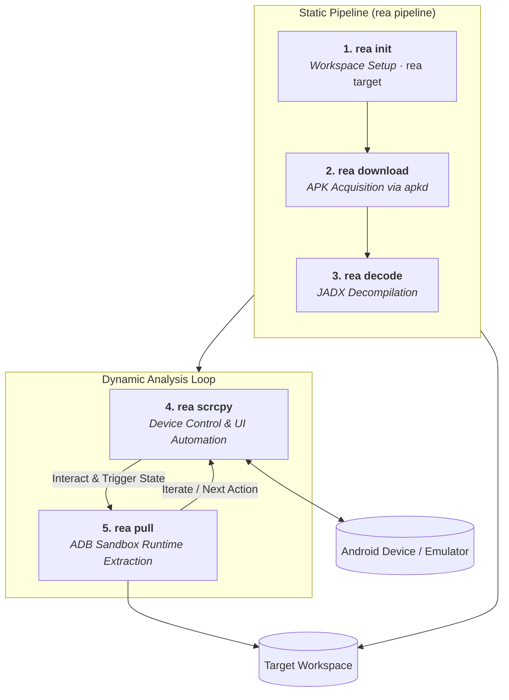

# Reverse Engineering Android Kit (REAKit)
---
## Installation & Setup

Clone the repository with submodules and run the main installer:

```bash
git clone --recurse-submodules https://github.com/impeterwayne/REAKit.git
cd REA_Kit
python rea.py install
```

> **Windows Batch Alternative**: You can also run `install.bat` from the root directory.

### Verify Installation:
```bash
rea env
```

---
## Architecture

`REA_Kit` is partitioned into clean, modular components coordinated by a unified CLI engine:



---

## Documentation Index

1. **[CLI Reference Manual](./docs/cli_reference.md)** - Comprehensive manual for the `rea` CLI and all 12 subcommands.
2. **[Device Control & Automation Guide](./docs/scrcpy_control.md)** - Low-latency scrcpy daemon control and automation actions.
3. **[Workspace Setup & Management Guide](./docs/workspace_management.md)** - Directory schemas and target workspace management.
4. **[Target Downloading Guide](./docs/downloading_targets.md)** - Automated APK downloading via `apkd`.
5. **[Bytecode Decompilation & JADX Guide](./docs/decompilation.md)** - JADX memory safeguards, split APK merging, and decompilation.
6. **[Runtime Extraction Guide](./docs/runtime_extraction.md)** - ADB privilege escalation (native root, Magisk su, run-as) and sandbox pulling.
7. **[Configuration Schema Guide](./docs/workspace_config.md)** - Central `workspace_config.json` schema details.

---

## Prerequisites

To run all capabilities of `REA_Kit`, ensure the following packages are installed:

* **Python 3.8+** (runs the `reakit` engine).
* **Java Development Kit (JDK) 11+** (required for `JADX` decompiler and `APKTool`).
* **Node.js 22+** (required for `scrcpy-cli` device automation).
* **A Connected Device or Emulator** (physical device, Genymotion, or Android Studio AVD).
