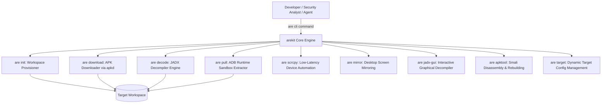

# Android Reverse Engineering Kit (ARE_Kit) Documentation

Welcome to the **Android Reverse Engineering Kit (ARE_Kit)** documentation. This suite provides a robust, developer-centric toolkit and unified CLI to automate downloading, decompilation, analysis, runtime extraction, and device control for Android applications.

Whether you are performing malware analysis, security audits, business intelligence analysis, application benchmarking, or automated UI testing, `ARE_Kit` standardizes the workflow.

---
## Installation & Setup

Clone the repository with submodules and run the main installer:

```bash
git clone --recurse-submodules https://github.com/impeterwayne/ARE_Kit.git
cd ARE_Kit
python are.py install
```

> **Windows Batch Alternative**: You can also run `install.bat` from the root directory.

### Verify Installation:
```bash
are env
```

---
## Architecture

`ARE_Kit` is partitioned into clean, modular components coordinated by a unified CLI engine:



---

## Documentation Index

1. **[CLI Reference Manual](./docs/cli_reference.md)** - Comprehensive manual for the `are` CLI and all 12 subcommands.
2. **[Device Control & Automation Guide](./docs/scrcpy_control.md)** - Low-latency scrcpy daemon control and automation actions.
3. **[Workspace Setup & Management Guide](./docs/workspace_management.md)** - Directory schemas and target workspace management.
4. **[Target Downloading Guide](./docs/downloading_targets.md)** - Automated APK downloading via `apkd`.
5. **[Bytecode Decompilation & JADX Guide](./docs/decompilation.md)** - JADX memory safeguards, split APK merging, and decompilation.
6. **[Runtime Extraction Guide](./docs/runtime_extraction.md)** - ADB privilege escalation (native root, Magisk su, run-as) and sandbox pulling.
7. **[Configuration Schema Guide](./docs/workspace_config.md)** - Central `workspace_config.json` schema details.

---

## Unified CLI & Core Workflow

The kit automates the core stages of Android Application analysis:

1. **Workspace Initialization (`are init`)**
   Reads targets and structures standard workspaces.
   *See [Workspace Setup & Management Guide](./docs/workspace_management.md) for usage details.*

2. **Target Downloading (`are download` / `are dl`)**
   Downloads target application files securely from remote sources using the Go-based APK downloader.
   *See [Target Downloading Guide](./docs/downloading_targets.md) for download configurations.*

3. **Decompilation (`are decode` / `are decompile`)**
   Extracts bytecode, merges split APKs (`.xapk`/`.apks`), and decompiles into readable Java Gradle projects using JADX.
   *See [Decompilation Guide](./docs/decompilation.md) for decompiling options.*

4. **Runtime Sandbox Extraction (`are pull` / `are runtime`)**
   Elevates shell privileges (root/su/run-as) and pulls app internal databases and shared preferences directly from emulator or device sandboxes.
   *See [Runtime Extraction Guide](./docs/runtime_extraction.md) for ADB privilege negotiation.*

5. **Device Automation & Control (`are scrcpy` / `are mirror`)**
   Low-latency tap, swipe, key injection, screenshot capture, UI dumping, and interactive screen mirroring.
   *See [Device Control & Automation Guide](./docs/scrcpy_control.md) for automation features.*

6. **GUI & Smali Workflows (`are jadx-gui` / `are apktool`)**
   Interactive class exploration, code search, and low-level Smali editing.

7. **Target & Config Lifecycle (`are target`)**
   Dynamically add, remove, and list workspace applications without touching raw JSON files.

---


## Prerequisites

To run all capabilities of `ARE_Kit`, ensure the following packages are installed:

* **Python 3.8+** (runs the `arekit` engine).
* **Java Development Kit (JDK) 11+** (required for `JADX` decompiler and `APKTool`).
* **Node.js 22+** (required for `scrcpy-cli` device automation).
* **A Connected Device or Emulator** (physical device, Genymotion, or Android Studio AVD).

