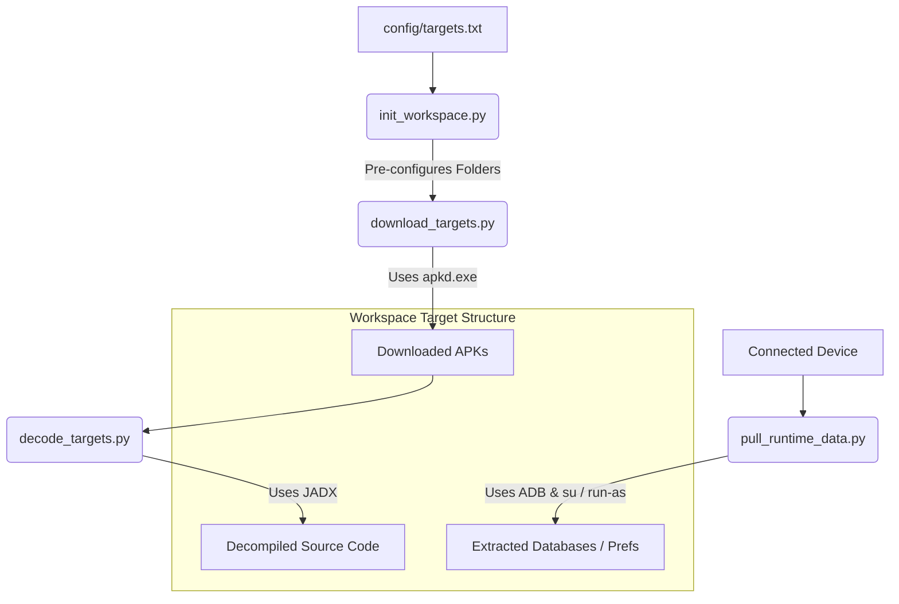

# Android Reverse Engineering Kit (ARE_Kit) Documentation

Welcome to the **Android Reverse Engineering Kit (ARE_Kit)** documentation. This suite provides a robust, developer-centric set of tools to automate the downloading, decompilation, analysis, and runtime extraction of Android applications in isolated environments.

Whether you are performing malware analysis, security audits, business intelligence analysis, or application benchmarking, `ARE_Kit` standardizes the workflow.

---

## 🏗️ High-Level Architecture

`ARE_Kit` is designed to be highly modular. The flow is partitioned into clean steps, moving from target definition to source code analysis and runtime extraction:



---

## 📁 Repository Structure

Here is a quick overview of the kit layout:

```text
ARE_Kit/
├── config/
│   ├── targets.txt            # Target package names or Google Play links
│   └── workspace_config.json  # Global workspace structure & alias configurations
├── core/
│   ├── apkdgo/                # Bundled APK download engine (apkd.exe)
│   └── jadx/                  # Bundled JADX Decompiler
├── docs/                      # Technical Documentation (This Directory)
├── scripts/
│   ├── init_workspace.py      # Pre-configures isolated workspace directories
│   ├── download_targets.py    # Downloads APK packages automatically
│   ├── decode_targets.py      # Invokes JADX with aggressive/safe parsing flags
│   └── pull_runtime_data.py   # Extracts sandbox data via ADB (run-as or root)
└── workspaces/                # Target sandbox databases and source directories
```

---

## 🚀 Core Scripts & Workflow

The kit automates the four primary stages of Android Application analysis:

1. **Workspace Initialization (`init_workspace.py`)**
   Reads targets and structures standard workspaces.
   👉 *See [Workspace Setup & Management](workspace_management.md) for usage details.*

2. **Target Downloading (`download_targets.py`)**
   Downloads target application files securely from multiple remote sources using the custom Go-based APK downloader.
   👉 *See [Target Downloading Guide](downloading_targets.md) for download configurations.*

3. **Decompilation (`decode_targets.py`)**
   Extracts bytecode, decompiles into readable Java source code, and sets up fully functional Gradle project templates using JADX.
   👉 *See [Decompilation Guide](decompilation.md) for decompiling options.*

4. **Runtime Sandbox Extraction (`pull_runtime_data.py`)**
   Elevates shell privileges, circumvents standard filesystem sandboxing via debug run-as or root su commands, and pulls app internal databases/shared preferences directly from standard emulator and device sandboxes.
   👉 *See [Runtime Extraction Guide](runtime_extraction.md) for ADB privilege negotiation.*

---

## 🛠️ Prerequisites

To run all capabilities of `ARE_Kit`, ensure the following packages are installed and configured:

* **Python 3.8+** (with standard library dependencies).
* **Java Development Kit (JDK) 11+** (required for `JADX` decompiler to run).
* **Android Debug Bridge (ADB)** (configured in your system `PATH` for runtime data extraction).
* **A Connected Device or Emulator** (Genymotion, Android Studio AVD, or rooted physical device for runtime extraction).

---

## 🧭 Centralized Configuration

All tools read from a central `config/workspace_config.json` configuration file, making it easy to change output folder layouts or default targets.
👉 *See [Configuration Scheme](workspace_config.md) for schema details.*
