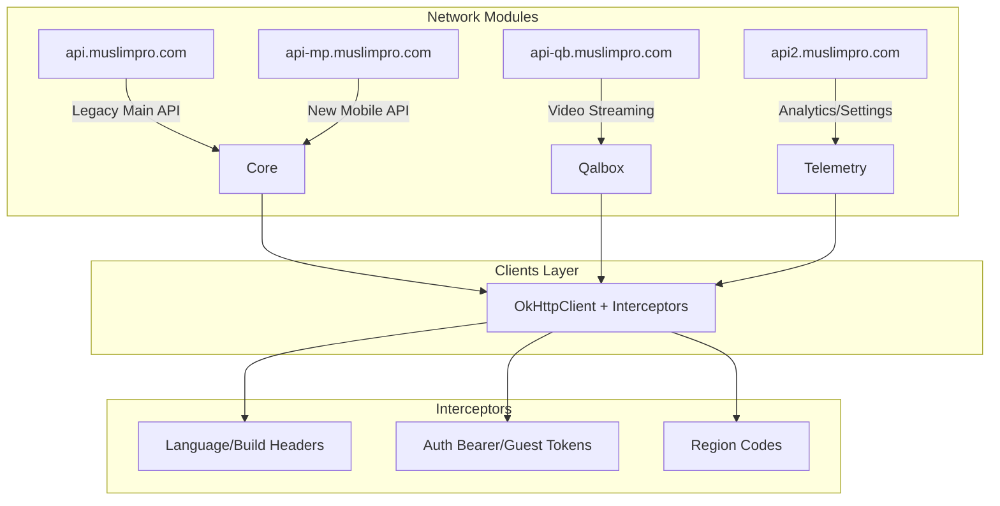

# Muslim Pro — API Contracts & Network Layer

> **Source:** Decompiled APK static analysis
> **Note:** Exact endpoint URLs may be obfuscated or dynamically constructed

---

## 🚀 Postman Collection Available
A complete, importable Postman JSON file mapping ~120 API endpoints has been generated in the documentation folder: 
**[MuslimPro_Postman_Collection.json](MuslimPro_Postman_Collection.json)**

---

## 1. Obfuscation Key (Retrofit Annotations)

The mapping between obfuscated names and original Retrofit annotations was reverse-engineered from `accessgetInfoText.java` (the Retrofit core proxy class).

| Obfuscated Annotation                | Original Retrofit Annotation |
|---------------------------------------|------------------------------|
| `@accesspreTransformJiSxe2E`         | `@POST`                     |
| `@InterfaceC0035x31b42405`           | `@GET`                      |
| `@preTranslatecG2Xzmc`              | `@PUT`                      |
| `@isScreenReaderFocusable`           | `@DELETE`                   |
| `@accesscontainsDescendant`          | `@PATCH`                    |
| `@setTraversalValues`               | `@HEAD`                     |
| `@accesspreTranslatecG2Xzmc`        | `@OPTIONS`                  |
| `@setViewTranslationCallback`       | `@HTTP` (custom method)     |
| `@AndroidComposeView_androidKt`     | `@Headers`                  |
| `@accessgetContentCaptureSessionCompat` | `@Multipart`             |
| `@propertiesDeleted`                 | `@FormUrlEncoded`           |

---

## 2. Base URLs & Network Configuration

### 2.1 API Base URLs

| Base URL | Purpose | Source File |
|---|---|---|
| `https://api.muslimpro.com` | Primary API server (legacy/main) | `api/di/NetworkModule.java` |
| `https://api-mp.muslimpro.com` | New main API server (with custom headers) | `rest_api/network/NetworkModule.java` |
| `https://api-qb.muslimpro.com` | Qalbox streaming/video service | `QalboxNetworkModule.java` |
| `https://api2.muslimpro.com` | Settings & Analytics API | various Retrofit interfaces |
| `https://us-central1-muslim-pro-app.cloudfunctions.net/` | Firebase Cloud Functions | `api/di/NetworkModule.java` |

### 2.2 HTTP Headers (Interceptor)

All API requests to `api-mp.muslimpro.com` and `api-qb.muslimpro.com` inject:

| Header | Value | Description |
|---|---|---|
| `Content-Type` | `application/json` | |
| `mp-app-language` | Device language (e.g. `en`) | Used for content localization |
| `mp-app-build` | `1700040401` | Hardcoded app version identifier |
| `mp-platform` | `android` | Platform tag |
| `mp-country-code` | Device country code | Regional feature flags / ads configuration |
| `mp-guest-id` | Guest user identifier | Only used on the api-mp domain |

---

## 3. Core API Endpoints Directory

*(Refer to the Postman Collection for the complete list and easy testing).*

### 3.1 App Init & Config
- **POST/GET** `v1/muslimpro/app/init`
- **POST/GET** `v1/muslimpro/app/config`
- **GET** `v1/muslimpro/app/images`
- **GET** `v1/settings`
- **GET** `v1/today-page/tasks`

### 3.2 Authentication & Profile
- **POST** `v1/auth/otp/send` / `verify`
- **POST/GET** `v1/muslimpro/oauth2/internal/authorize`
- **GET/POST/PATCH** `v1/users/{uid}/profile`
- **GET** `v1/users/{uid}/account` / `devices` / `premium`
- **GET/POST** `v1/users/{uid}/settings/app`

### 3.3 Core Islamic Features (Prayer, Quran, Zakat)
- **POST/GET** `v1/muslimpro/features/prayer-tracker`
- **GET** `v1/content/quran/surah/{surah_id}`
- **GET/POST** `v1/muslimpro/features/quran`
- **GET/POST** `v1/muslimpro/features/zakat/calculate`
- **GET** `v1/content/daily-verses`

### 3.4 Qalbox Streaming
- **POST/GET** `v1/qalbox/media` (and `/search`, `/featured`, `/recommendation`)
- **GET** `v1/qalbox/media/{media_id}/play-next`
- **GET** `v1/qalbox/course/{id}`
- **GET/POST** `v1/qalbox/course/module/enrollment`
- **GET/POST** `v1/qalbox/course/watchlist`
- **GET** `v1/qalbox/purchases/{session_id}/status`

### 3.5 Community & Social
- **POST/GET** `v1/community/posts`
- **DELETE** `v1/community/posts/{post_id}`
- **POST** `v1/community/posts/{post_id}/comments`
- **POST** `v1/community/images`
- **POST** `v1/community/react`
- **POST** `v1/challenges/{challenge_id}/participate`

### 3.6 Gamification (Rewards & Wallet)
- **GET** `v1/rewards` and `/summary`
- **POST** `v1/rewards/quests/submit`
- **POST** `v1/rewards/redeem`
- **GET** `v1/wallet`
- **GET** `v1/wallet/transactions/history`

### 3.7 Search Bot / AI Chat
- **GET** `v1/search-bot/init`
- **POST** `v1/search-bot/query`
- **POST** `v1/search-bot/feedback`

---

## 4. Third-Party Services APIs

### 4.1 Zendesk Support (Help Center)
- Connected to: `api/mobile/requests.json`
- `hc/api/mobile/{locale}/articles/{article_id}.json`
- Over 25 endpoints for ticket submission, knowledge base management, and help center analytics.

### 4.2 Purchasely (IAP Module)
- Base path: `app/{sha1}/`
- Used for presenting paywalls (`presentations/{presentationId}`)
- Verifying purchases (`playstore/purchases`, `huawei/purchases`)
- Logs and tracking API events

### 4.3 Firebase Integration
- `Firebase Auth` for token management.
- `Firebase Analytics` / `BigQuery` for event logging (e.g. `v1/bigquery/logevent` via `api2.muslimpro.com`).
- Shared preferences mapped using Firebase Cloud models (Dhikr items, Zakat balances).

---

## 5. Architectural Diagram



---

## Deep Link Routing Schema

Deep links map directly to views that fetch from these APIs:
```text
muslimpro://prayers          → Prayer times
muslimpro://quran            → Quran reader
muslimpro://quran-search     → Quran search
muslimpro://tasbih           → Tasbih counter
muslimpro://zakat            → Zakat calculator
muslimpro://qalbox           → Qalbox Video
muslimpro://ummah            → Community Hub
muslimpro://academy          → Iqra Learning
```
