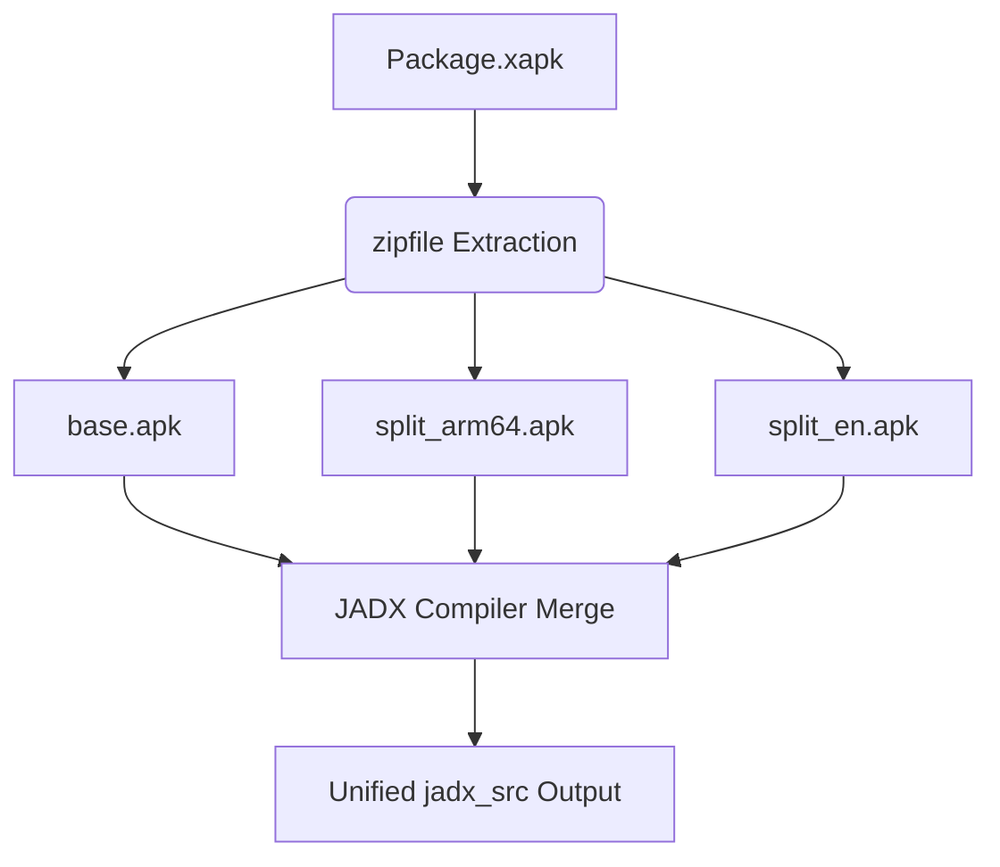

# Bytecode Decompilation & JADX Guide

This guide covers the static decompilation workflow in **ARE_Kit**, which converts raw Android application archives into navigable Java codebases and Gradle projects.

---

## 🔍 Decompilation Orchestrator (`decode_targets.py`)

Decompiling modern Android apps can be resource-heavy and complex. The script `scripts/decode_targets.py` manages execution parameters, allocates memory safeguards, detects system capabilities, handles package variations, and runs the open-source **JADX** decompiler.

### Command-line Syntax

```bash
python scripts/decode_targets.py [options]
```

### Argument Reference

| Flag | Long Option | Default | Description |
|---|---|---|---|
| *None* | `--config` | `config/workspace_config.json` | Path to the global workspace configuration file. |
| *None* | `--targets` | `config/targets.txt` | Path to the targets list containing package names or links. |
| *None* | `--link` | *None* | Decompile a single direct package name or package link (ignores `targets.txt`). |

---

## ⚡ Multi-threading & Out-of-Memory (OOM) Safeguards

Large apps often crash standard JADX processes due to heap limits. `decode_targets.py` implements the following environment safeguards:

1. **Aggressive Heap Reservation:**
   The script checks if `JADX_OPTS` is defined in the system. If absent, it automatically forces a high memory limit:
   ```bash
   JADX_OPTS="-Xmx8g -Xms8g"
   ```
   This reserves 8 GB of JVM heap memory, preventing Out-Of-Memory exceptions during resource-heavy decompilations.

2. **Dynamic CPU Core Allocation:**
   The script automatically queries the CPU core configuration (`os.cpu_count()`) and forwards this value to the JADX threading argument (`-j <cores>`). This ensures the CPU is fully leveraged during parallel decompilation phases.

---

## 🛡️ JADX Configuration & Analysis Flags

The script applies specific analysis flags to ensure code readability and accuracy for security reviews:

```text
--export-gradle                       # Generates an Android Studio-ready Gradle project layout
--deobf                               # Renames obfuscated (a, b, c) symbols into unique names
--add-debug-lines                     # Restores debug line comments inside decompiled classes
--comments-level debug                # Adds warnings, errors, and parsing issues directly in source files
--respect-bytecode-access-modifiers   # Retains original class/method visibilities (public, private)
--no-inline-anonymous                 # Prevents inlining anonymous classes to isolate call logic
--no-inline-methods                   # Prevents inlining method bodies to preserve signature references
--no-replace-consts                   # Keeps raw constants intact instead of matching them against constants definitions
```

---

## 📦 Multi-APK split installations (`.xapk` and `.apks`)

Modern applications on the Play Store are often delivered as Split APKs (app bundles) which cannot be parsed in isolation. `decode_targets.py` automatically detects and processes these archives:

1. **Auto-Detection:** Identifies files ending with `.xapk` or `.apks` inside the target's `apks/` directory.
2. **Extraction:** Recursively unpacks the zip archives into a temporary `_extracted/` directory.
3. **Split Aggregation:** Gathers the `base.apk` alongside all auxiliary localized splits (e.g. `split_config.arm64_v8a.apk`, `split_config.en.apk`).
4. **Unified Merging:** Executes JADX with the entire list of split APK paths, generating a single, cleanly reconstructed Java codebase.



---

## 📖 Practical Examples

### Example 1: Decompile target packages from config
Decompile all packages configured in your workspace:

```bash
python scripts/decode_targets.py --config config/workspace_config.json
```

### Example 2: Decompile a single target by package name
Decompile a single package on demand:

```bash
python scripts/decode_targets.py --link com.lichess.mobileV2
```

> [!IMPORTANT]
> Make sure to install a Java Development Kit (JDK) 11 or higher. JADX relies entirely on a JVM to operate. If JADX is not found in the `core/jadx/bin/` workspace subdirectory, the script will fall back to executing `jadx` from your system `PATH`.
