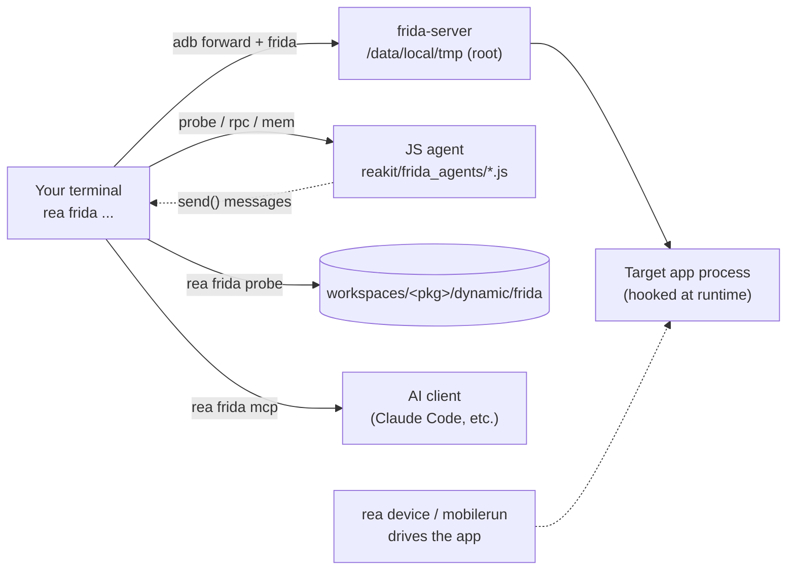

# Dynamic Instrumentation Guide (`rea frida`)

Static analysis tells you what an app *could* do and the network tells you what it *sends*;
instrumentation tells you what it *is doing right now*, inside the process. `rea frida` is the
runtime half of a target, alongside `rea native` (compiled code), `rea http` (the wire) and
`rea pull` (on-device files). It drives [Frida](https://frida.re) from the `rea` CLI:

1. **Manage** frida-server on the device — download the build matched to your host Frida version
   and the device ABI, push it, and start it.
2. **Enumerate / spawn / attach** processes, and inject JavaScript agents into them.
3. **Hook** Java and native methods, **call** the app's own functions over `rpc.exports`, and
   **read / scan / write** process memory.
4. Persist probe output into the workspace, beside the APKs, decompiled sources and traffic.

Like the rest of REA_Kit, `reakit/fridakit.py` is **stdlib-only**: the `frida` Python package is an
*optional* backend, imported lazily and only when you actually instrument. A plain install never
pulls it in.



---

## 1. One-time setup

| Requirement | Notes |
|---|---|
| **Rooted device / emulator** | frida-server runs as root in `/data/local/tmp`. `rea frida setup` starts it with `su`. A Magisk-rooted device or a rooted AVD works. |
| **ADB** | Already bundled with REA_Kit (`core/scrcpy_cli/vendor/scrcpy/adb.exe`). |
| **Host `frida` package** *(optional)* | Only needed to actually instrument: `pip install 'frida==17.*'`. `rea frida doctor` tells you if it is missing. |
| **`frida-tools`** *(optional, for Java/ObjC)* | frida 17 dropped the built-in Java/ObjC/Swift bridge; REA_Kit loads it on demand from the `frida-tools` package. `pip install 'frida-tools'` to hook Java/ObjC. Native-only hooking needs neither. |

REA_Kit downloads the matched frida-server automatically and caches it under `~/.reakit/frida-cache`.
You rarely need to configure anything, but you can pin the particulars:

```jsonc
// workspace_config.json
{
  "fridaServerPort": 27042,     // device port frida-server listens on
  "fridaVersion": "17",         // major track (resolves to latest 17.x) or an exact version
  "fridaServerName": "frida-server"  // on-device binary name (rename to disguise it)
}
```

...or via environment variables: `FRIDA_PORT`, `FRIDA_VERSION`, `FRIDA_SERVER_NAME`.

```bash
rea frida doctor    # host module + CLI, adb, device ABI, server liveness + version match, root
rea frida setup     # download + push + start a version/ABI-matched frida-server
```

---

## 2. How REA_Kit talks to Frida

`rea frida` prefers an **explicit remote device over USB auto-select**: it runs
`adb forward tcp:<port> tcp:<port>` and connects to `127.0.0.1:<port>`. This avoids attaching to the
wrong device (e.g. an emulator) and works consistently across transports.

Every blocking Frida call is a thin wrapper; sessions are keyed by `(device, pid)` and pruned when
the target detaches. Agent output arrives as `send(...)` messages, buffered per-script (locked and
size-capped) and drained when you read them.

> **Version alignment is a hard gate.** The host `frida` package and the device `frida-server` must
> be the **same version**. `rea frida doctor` reports `version_match`; `rea frida setup` downloads
> the server matched to your host package. A mismatch shows up as `connection closed`.

### The Java/ObjC bridge on frida 17

REA_Kit targets **frida 17.x** by default. frida 17 removed the built-in `Java`/`ObjC`/`Swift`
globals, so any agent that uses them needs the bridge loaded first. REA_Kit does this
automatically: when an injected script references `Java.`/`ObjC.`/`Swift.`, a small loader prelude
is prepended and the bridge source is served from the host's installed `frida-tools` package
(cached under `~/.reakit/frida-bridges`). `pip install 'frida-tools'` is therefore required for
Java/ObjC hooking on 17 — native-only hooking needs neither. If you pin frida 16 instead
(`fridaVersion: "16"`), its built-in bridge is used and the loader is a no-op.

### frida-server lifecycle

```bash
rea frida setup                     # one-shot: download (matched version+ABI) → push → start
rea frida setup --version 16.5.9    # pin an exact version
rea frida server status             # pidof + on-device --version + version_match
rea frida server start              # start an already-installed server (su -c setsid, detached)
rea frida server stop               # pkill frida-server
rea frida server install --force    # re-download/push (stops the old server first)
```

The server is started **detached from the adb shell** (`su -c 'setsid … &'`) so it survives the
shell closing. On a device whose ROM hunts instrumentation, re-check `rea frida server status`
before each session — some ROMs kill it.

---

## 3. A dynamic session, end to end

```bash
rea frida doctor                      # confirm the backend is live
rea frida ps --running                # find the target; note its PID
rea frida probe com.example.app --script probe_net --spawn --duration 120
# ...in another terminal, drive the app:
rea device tap 500 1200
```

Spawn when timing matters (startup, first network call); attach otherwise. When spawning, hooks are
installed **before the process resumes**, so nothing in early init is missed. Probe output streams
live and is copied to `workspaces/<pkg>/dynamic/frida/`.

### Target selection

`rea frida` mirrors the Frida CLI's process selectors:

| Flag | Selects |
|---|---|
| `-p, --pid <pid>` | an exact PID (preferred — frida's own enumeration can omit a running app) |
| `-n, --name <name>` | by process name |
| `-N, --identifier <id>` | by application identifier (package) |
| `-F, --frontmost` | whatever is in the foreground |

With no selector, the sole workspace / first configured target is used.

---

## 4. Bundled agents

Pass one by name to `--script`, or point `--file` at your own `.js`. They live in
`reakit/frida_agents/`.

| Agent | What it does |
|---|---|
| `probe_net` | Four-layer network probe: app wrapper classes, OkHttp chain, `java.net.URL`, DNS, and swallowed `Throwable`s. Per-hook guarded; emits a `READY` summary. |
| `anti_detect` | Observer-only (never patches): what the app checks for root/frida/debug (`/proc`, `su`, `ptrace`, `TracerPid`, frida maps) and who called it. Heartbeat + first-hit so events survive a kill. |
| `stalker_trace` | Basic-block Stalker tracer for one native module (OLLVM/CFF deobfuscation). Post-process the log offline. |
| `rpc_template` | Editable `rpc.exports` starting point: frida 16/17 `resolveExport` shim, `getpackagename`, and `callnative`/`callnativeaddr` wrappers for calling the app's own exported/offset-addressed functions. |
| `hook_patch` | Minimal native death-site neutralizer: `Memory.patchCode` at a module+offset (survives detach). |
| `mem_helper` | The persistent memory agent behind `rea frida mem` (read / write / `Memory.scanSync` / protect). You don't invoke it directly. |

---

## 5. Calling the app's own code (RPC)

```bash
rea frida rpc com.example.app --file ./rpc.js --call getpackagename
rea frida rpc com.example.app --file ./rpc.js --call callnativeaddr 0x1234 ba de   # NativeFunction wrapper
rea frida rpc com.example.app --file ./rpc.js --repl                  # interactive
rea frida rpc com.example.app --file ./rpc.js --http 8099             # POST /rpc bridge
```

Start from `rpc_template.js`. The three modes (`--call`, `--repl`, `--http`) are mutually exclusive.
`callnative`/`callnativeaddr` let you invoke the app's own crypto/signing routine directly instead
of reimplementing it.

---

## 6. Memory and native

```bash
rea frida mem read    com.example.app --address 0x7f00 --size 64
rea frida mem scan    com.example.app --address 0x7f00 --size 4096 --pattern "de ad ?? ef"
rea frida mem write   com.example.app --address 0x7f00 --hex "90 90"
rea frida mem protect com.example.app --address 0x7f00 --size 16 --prot rwx
rea frida inject-lib  com.example.app --path /data/local/tmp/x.so --entrypoint init
rea frida gating enable com.example.app --child      # catch forked children before they run
```

`mem scan` uses `Memory.scanSync`, and all memory-op parameters are passed as RPC arguments (never
interpolated into JS), so patterns and addresses can't break the agent.

---

## 7. Command reference

| Command | Aliases | Description |
|---|---|---|
| `rea frida setup` | | Download a version/ABI-matched frida-server and start it (`--version`, `--force`, `-s`, `--port`) |
| `rea frida doctor` | | Check every prerequisite (host module, adb, server, root, version match) |
| `rea frida server <status\|start\|stop\|install>` | | Manage the on-device frida-server (`install`: `--version`, `--force`) |
| `rea frida ls` | | List devices Frida can see |
| `rea frida ps` | | List processes (`--apps` for installed apps, `--running`, `--json`) |
| `rea frida probe [target]` | | Inject a probe and stream it (`--script`, `--file`, `--spawn`, `--duration`, `--runtime`) |
| `rea frida spawn <program>` | | Spawn a program under Frida (`--no-resume`, `--argv`) |
| `rea frida attach <target>` | | Attach to a running process (`-p/-n/-N/-F`) |
| `rea frida rpc <target>` | | Load a script and call its exports (`--file`, `--call`, `--repl`, `--http`, `--runtime`) |
| `rea frida mem <read\|write\|scan\|protect> <target>` | | Memory ops (`--address`, `--size`, `--hex`, `--pattern`, `--prot`) |
| `rea frida inject-lib <target>` | | Inject a native library (`--path`, `--blob`, `--entrypoint`, `--data`) |
| `rea frida gating <enable\|disable> <target>` | | Spawn / child gating (`--child`) |
| `rea frida mcp` | | Run a Frida MCP bridge for AI clients (`--config`) |

Command aliases: `rea frida` also answers to `rea fr` and `rea instrument`.

---

## 8. For AI clients

```bash
rea frida mcp --config     # print ready-to-paste MCP client configuration
rea frida mcp              # run the stdio MCP bridge
```

The bridge prints only to stderr so it never corrupts the stdio JSON-RPC stream, matching the
`rea http mcp` and `rea native mcp` pattern.

---

## 9. Troubleshooting

| Symptom | Cause / fix |
|---|---|
| `frida package not installed` | Optional backend absent. `pip install 'frida==17.*'`. |
| `connection closed` at attach | frida-server not running or version mismatch. `rea frida doctor`, then `rea frida setup`. |
| Java bridge missing / `Java is not defined` | On frida 17 the bridge is loaded from `frida-tools`. Install it: `pip install 'frida-tools'` (matching your frida version). Or pin frida 16 (`fridaVersion: "16"`, `pip install 'frida==16.*'`) to use its built-in bridge. |
| `su: not found` / server won't start | Device isn't rooted; frida-server needs root to run from `/data/local/tmp`. |
| Probe fires zero events | Check the class is present, the Java bridge loaded, the UI was reached, and the server is still alive (`rea frida server status`). |
| Server dies between runs | The ROM is killing instrumentation. Re-run `rea frida server start` before each session; consider renaming it via `fridaServerName`. |
| HTTPS still fails after a probe | Certificate pinning — hook it (unpinning agent) rather than fighting the proxy. See `docs/http_toolkit.md`. |
| `wrong device` attached | USB auto-select picked another device. Pass `-s <serial>`; `rea frida` forwards and connects to `127.0.0.1:<port>` explicitly. |
