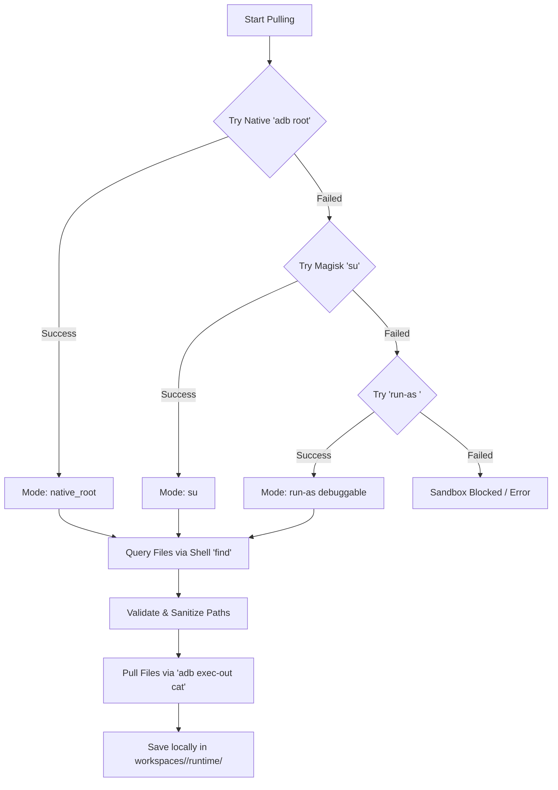

# Android Runtime Sandbox Data Extraction Guide

This guide details how to automatically pull dynamic application storage data (sandbox files, databases, shared preferences, caches) from physical devices and emulators using **ARE_Kit**.

---

## 🔍 Sandbox Data Puller (`pull_runtime_data.py`)

During application execution, Android locks internal app state behind user isolation sandboxes (`/data/data/<package_name>`).

The script `scripts/pull_runtime_data.py` bridges this sandbox boundary by negotiating permissions and downloading directories, databases (SQLite), Shared Preferences (XML), and custom caches directly into your local workspace.

### Core Extraction Architecture



---

## 🛡️ Sequential Privilege Escalation Negotiation

The script automatically executes a 3-tier fallback strategy to access locked internal files:

### Tier 1: Native ADB Daemon Root (`native_root`)
* **Target Environment:** Standard Android Virtual Devices (AVD), Genymotion, or engineering firmware.
* **Mechanism:** Runs `adb root` to elevate the ADB daemon directly to root. Then lists and copies files natively.

### Tier 2: Magisk Superuser Elevation (`su`)
* **Target Environment:** Rooted physical devices.
* **Mechanism:** Runs finding commands wrapped via Magisk shell elevation:
  ```bash
  adb shell "su -c 'find /data/data/<pkg> -type f'"
  ```
  File reads are executed via piping `su -c cat <file>` through ADB to bypass Unix permissions.

### Tier 3: Debuggable Run-As Sandbox Entry (`run-as`)
* **Target Environment:** Non-rooted devices running debug-built applications.
* **Mechanism:** Runs instructions directly under the target package's application UID:
  ```bash
  adb shell run-as <package_name> find /data/data/<package_name> -type f
  ```
  This is a powerful technique enabling developers to test local data structures on real hardware without cracking device security.

---

## 🔒 Security: Path Traversal & Sanitization Safeguards

Transferring file structures from Unix-based Android devices to Windows hosts can expose the system to security vulnerabilities. `pull_runtime_data.py` enforces active countermeasures:

* **Filename Sanitization:** Removes character sequences illegal on Windows filesystems (`<>:"\|?*`), replacing them with underscores to prevent OS filesystem exceptions.
* **Traversal Protections:** Computes PurePosixPath mappings relative to the app's base sandbox folder. Any file listing containing path injection elements (`.`, `..`, or absolute escapes) is discarded, preventing attackers from downloading arbitrary host files via malicious symlinks.

---

## 📖 Practical Examples

### Running the Data Puller
To execute standard extraction for your active target app:

```bash
python scripts/pull_runtime_data.py
```

### Extracted File Target Mapping
Extracted files are cleanly partitioned into local workspace directories:

* **Internal files:** Saved under `workspaces/<package_name>/runtime/internal/`. Examples include:
  * `shared_prefs/`: App configurations in XML format.
  * `databases/`: SQLite database files containing sensitive app states.
  * `cache/`: Temporary data stores.
* **External files:** Saved under `workspaces/<package_name>/runtime/external/`. Includes downloaded assets, public documents, and logs stored under the shared storage directory `/sdcard/Android/data/<package_name>`.

---

## ⚠️ Troubleshooting Access Blocks

If you receive the error:
`[!] Sandbox blocked read. Make sure the app is installed, device is rooted, or app is debuggable.`

1. **Verify ADB Connection:** Run `adb devices` to make sure your computer sees the Android hardware.
2. **Check App Status:** Make sure the package listed in `config/targets.txt` is fully installed and active on the device.
3. **Verify Root Permissions:** If using a rooted physical device, unlock your phone screen and check the Magisk app to confirm that Shell/ADB has been granted Superuser access.
